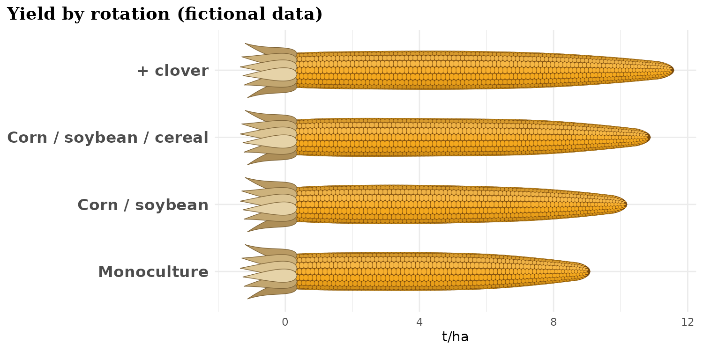
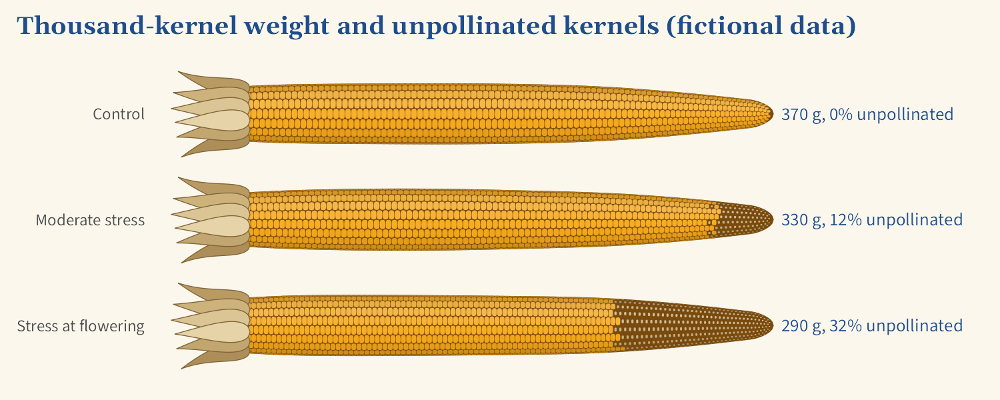
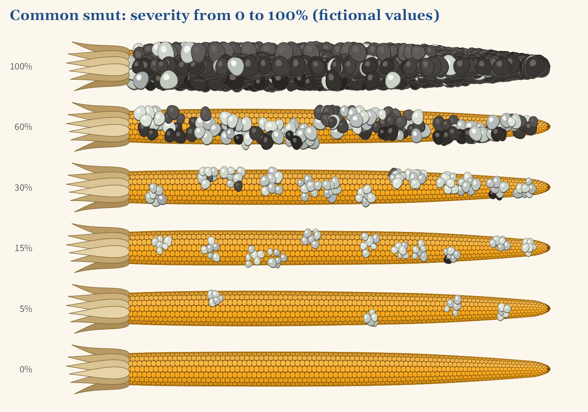
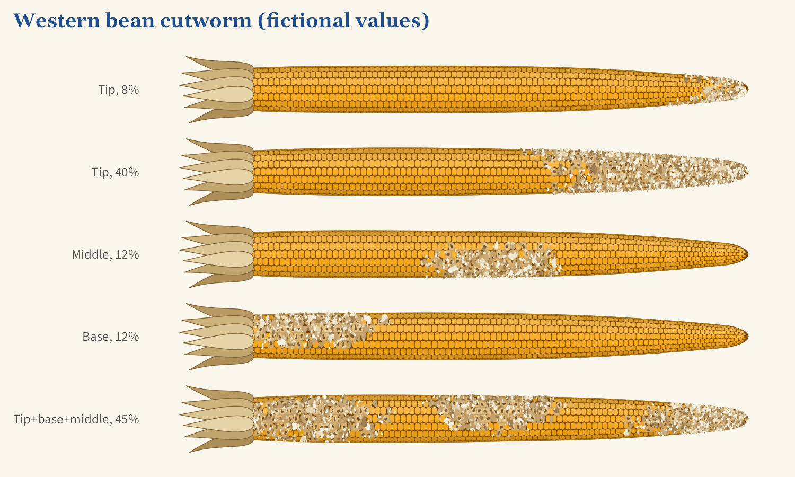
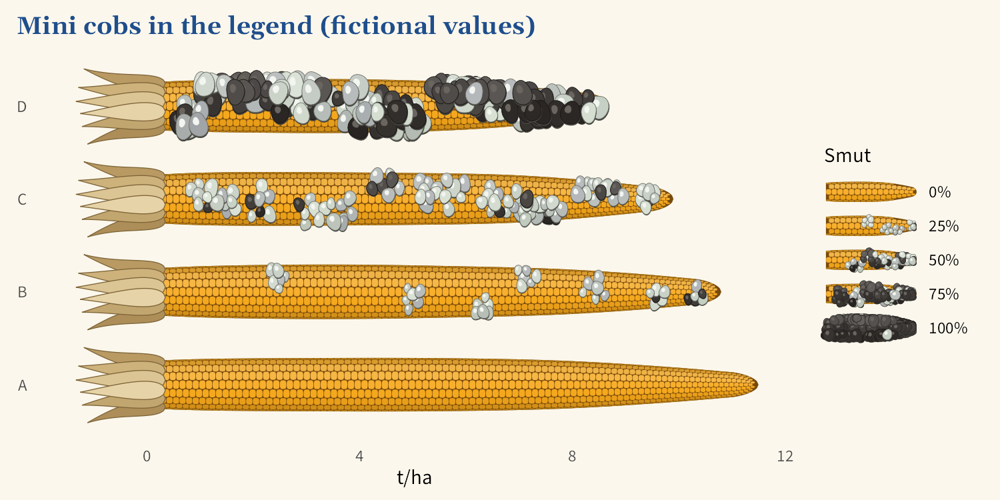
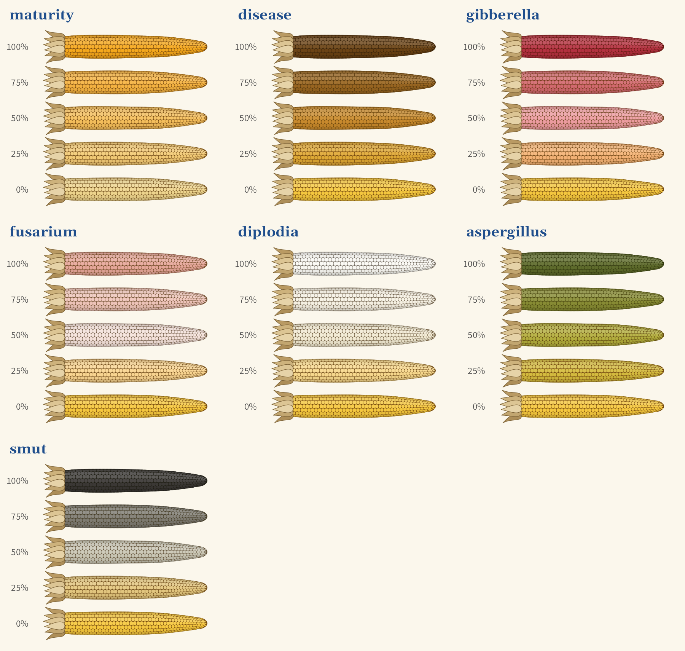

# ggcorn

`ggcorn` adds a `geom_cob()` layer to `ggplot2`. It works like `geom_col()`, except that each
bar is a corn cob with kernels and husks. The cob narrows toward the tip, and its full length
represents the value of `x`.



## Installation

```r
# install.packages("pak")
pak::pak("brucegelinas/ggcorn")
```

The package requires R 4.1 or later, `ggplot2` 3.5 or
later and `dplyr` 1.1 or later.

## Usage

```r
library(ggplot2)
library(ggcorn)

yields <- data.frame(
  rotation = factor(
    c("Monoculture", "Corn / soy", "Corn / soy / cereal", "+ clover"),
    levels = c("Monoculture", "Corn / soy", "Corn / soy / cereal", "+ clover")
  ),
  grain_yield = c(9.1, 10.2, 10.9, 11.6)
)

ggplot(yields, aes(x = grain_yield, y = rotation, fill = grain_yield)) +
  geom_cob() +
  scale_fill_cob_c() +
  labs(x = "Yield (t/ha)", y = NULL) +
  theme_corn()
```

Yield goes on `x` and the category on `y`. Any unit works: index, t/ha or bu/ac. Add
`coord_flip()` for vertical cobs.

| Argument | Purpose | Default |
|---|---|---|
| `kernels_per_cob` | Approximate number of kernels along the longest cob. Aim for about 45 in a small panel. | `90` |
| `thickness` | Share of the distance between two rows taken up by the cob. | `0.58` |
| `husks` | `FALSE` removes the husks and the margin reserved for them. | `TRUE` |
| `weight_amplification` | Exaggerates the difference in area between kernels. | `1` |
| `legend_kernel_size` | Height in mm of the largest kernel in the legend. | `9` |
| `legend_cob_width` | Width in cm of the mini cobs in the legend. | `2.4` |
| `weight_label` | Writes the thousand-kernel weight at the end of each cob. | `FALSE` |
| `weight_unit` | Unit written in the label. | `"g"` |
| `yield_label` | Writes yield at the end of each cob. | `FALSE` |
| `yield_unit` | Unit written in the yield label. | `"t/ha"` |
| `decimal_mark` | Decimal mark used in the labels. | `"."` |
| `label_size` | Label text size. | `4.2` |
| `label_family` | Label font family. | `""` |

## Theme

`theme_corn()` gives a cob plot a bold Georgia title aligned with the plot's left edge and bold
category labels.

```r
ggplot(yields, aes(x = grain_yield, y = rotation)) +
  geom_cob() +
  labs(
    title = "Diversifying the rotation increases yield",
    x = "Corn yield",
    y = NULL
  ) +
  theme_corn()
```

The title and category labels scale with `base_size`. If Georgia isn't installed, use another
family, such as `theme_corn(title_family = "serif")`. The x axis values are shown by default.
To hide them, use `theme_corn(x_values = FALSE)`.

## Making yield clear

A cob naturally reads as a cob, so readers may think the plot shows ear length. `yield_label =
TRUE` writes yield at the end of each cob, which removes most of that doubt.

```r
geom_cob(yield_label = TRUE, yield_unit = "t/ha")

# yield and thousand-kernel weight stack on two lines
geom_cob(aes(thousand_kernel_weight = tkw), yield_label = TRUE, weight_label = TRUE)

# decimal comma, for French
geom_cob(yield_label = TRUE, decimal_mark = ",")
```

A subtitle such as "Cob length represents yield, not actual ear size" helps too.

## Yield components

`thousand_kernel_weight` sets the kernel area: larger kernels mean fewer kernels on a cob of the
same length. `unpollinated` gives the percentage of unpollinated kernels, from 0 to 100. These
kernels are removed starting from the tip and leave the cob bare.

```r
ggplot(trial, aes(x = grain_yield, y = hybrid)) +
  geom_cob(aes(thousand_kernel_weight = tkw, unpollinated = unpollinated_kernels))
```



Kernel area is proportional to weight, and the highest weight on the plot is the reference. At
usual differences, the effect is subtle. `weight_amplification = 3` exaggerates it, but area is
then no longer proportional, so say so on the plot.

Kernel size illustrates a difference, but no value can be read from it: going from 280 to 380 g
adds only about 17% to a kernel's height. To give the value, write it at the end of each cob. The
axis keeps room for it.

```r
geom_cob(
  aes(thousand_kernel_weight = tkw),
  weight_label = TRUE,
  weight_unit = "g",
  label_size = 4.2,
  label_family = "Source Sans Pro"
)
```

Labels are off by default, as is the legend described below.

### Kernel size legend

The legend is hidden by default. When shown, it has one kernel per break, and kernel area follows
weight as it does on the cobs.

```r
ggplot(trial, aes(x = grain_yield, y = hybrid)) +
  geom_cob(aes(thousand_kernel_weight = tkw)) +
  guides(thousand_kernel_weight = "legend")

# to set the title and breaks as well
ggplot(trial, aes(x = grain_yield, y = hybrid)) +
  geom_cob(aes(thousand_kernel_weight = tkw)) +
  scale_thousand_kernel_weight_continuous(
    name = "1000-kernel weight (g)",
    breaks = c(280, 330, 380),
    guide = "legend"
  )
```

The absolute size of legend kernels does not match the kernels on the cobs, because `ggplot2`
draws the legend without knowing the final panel size. Compare legend kernels with each other, or
adjust `legend_kernel_size`.

## Common smut

`smut` gives the percentage of kernels covered by galls, from 0 to 100. Galls are not just a
color: they are clusters of silvery blisters that swell the cob's outline. As severity rises,
they grow, merge and turn black.

```r
geom_cob(aes(smut = severity))

# with the smut palette for the kernels still visible
geom_cob(aes(smut = severity, fill = severity)) +
  scale_fill_cob_c("smut")
```



The share of covered kernels follows the requested value within a few points, and reaches about
97% at 100. Gall positions are schematic: they don't represent data, but they stay the same from
one drawing to the next. The cob keeps its length, because galls never go past the value of `x`.

## Western bean cutworm

`western_bean_cutworm` gives the percentage of attacked kernels, from 0 to 100. Kernels are
punctured or hollowed, and a mix of flour and frass spills out of them. `cutworm_zone` sets where
the damage is: `"tip"` (the default), `"middle"`, `"base"` or a combination.

```r
# one zone for all cobs
geom_cob(aes(western_bean_cutworm = damage), cutworm_zone = "tip")

# a zone for each cob, from a column
geom_cob(aes(western_bean_cutworm = damage, cutworm_zone = zone))

# the column can contain "tip+middle" or "tip+base+middle"
```



The share of attacked kernels is exact. At the tip, damage wraps around the cob. At the middle and
base, it forms a patch on one side, like an entry through the husk. In a combination, each zone
grows at its own pace, so zones don't necessarily get equal shares of the damage. The exact
position of the patches is schematic.

## Symptom legends

Mapping `smut`, `western_bean_cutworm` or `unpollinated` adds a legend by default. Each key is a
mini cob showing the symptom at 0, 25, 50, 75 and 100%, so readers can match it to the plot.

```r
ggplot(trial, aes(x = grain_yield, y = hybrid)) +
  geom_cob(aes(smut = severity))

# change the title and breaks
ggplot(trial, aes(x = grain_yield, y = hybrid)) +
  geom_cob(aes(smut = severity)) +
  scale_smut_continuous(name = "Smut (%)", breaks = c(0, 50, 100))

# zoom in on low severities: breaks follow the limits
ggplot(trial, aes(x = grain_yield, y = hybrid)) +
  geom_cob(aes(smut = severity)) +
  scale_smut_continuous(limits = c(0, 20))
```



**To hide these legends:**

```r
# hide one legend
plot + guides(smut = "none")

# hide several legends
plot + guides(smut = "none", western_bean_cutworm = "none", unpollinated = "none")

# hide it in the scale
plot + scale_smut_continuous(guide = "none")

# hide every legend of the cob layer
geom_cob(aes(smut = severity), show.legend = FALSE)

# hide every legend of the plot
plot + theme(legend.position = "none")
```

The other scales are `scale_western_bean_cutworm_continuous()` and
`scale_unpollinated_continuous()`. Keys show cutworm damage at the tip, unless `cutworm_zone` is a
fixed value in `geom_cob()`. `legend_cob_width` sets the width of the mini cobs in cm. With two
legends at the bottom, add `theme(legend.box = "vertical")` so they stack and fit.

## Palettes

`aes(fill = ...)` colors the kernels. All seven palettes run from healthy to affected, except
`maturity`, which is designed for yield.

```r
# continuous variable
geom_cob(aes(fill = severity)) + scale_fill_cob_c("disease")

# classes
geom_cob(aes(fill = severity_class)) + scale_fill_cob_d("gibberella")

# low yield in brown, high yield in yellow
geom_cob(aes(fill = grain_yield)) + scale_fill_cob_c("disease", direction = -1)

# custom palette
geom_cob(aes(fill = severity)) + scale_fill_cob_c(c("#F7C93E", "#7A3E9D"))
```

### Keeping colors proportional to severity

With a disease palette, `scale_fill_cob_c()` reads values as percentages from 0 to 100. A low
severity therefore stays yellow, even if it is the highest on the plot.

```r
# percentage from 0 to 100: nothing to set
geom_cob(aes(fill = severity)) + scale_fill_cob_c("fusarium")

# 1 to 9 rating, treated as a number
geom_cob(aes(fill = rating)) + scale_fill_cob_c("fusarium", limits = c(1, 9))

# 1 to 9 rating, treated as classes
geom_cob(aes(fill = factor(rating))) + scale_fill_cob_d("fusarium", levels = 1:9)

# stretch the palette across the range of the data
geom_cob(aes(fill = severity)) + scale_fill_cob_c("fusarium", limits = NULL)
```

Without `levels`, `scale_fill_cob_d()` spreads the classes present across the whole palette: with
`factor()`, values of 2, 3 and 4 run from yellow to pink, whatever their size.



To see the colors in R, run `show_cob_palettes()`. The help page `?palettes_cob` shows them too.

Ear rot colors are schematic.

## Limits

- There is one cob per row, so `position_dodge()` is not supported. Use facets to compare groups.
- The whole cob takes one color, even if a rot actually starts from the tip or base.
- With `unpollinated`, the cob keeps its full length: if `x` is yield, the bare tip is part of the
  bar. To count only the filled part, put potential yield on `x`.
- The number of rows varies with kernel weight, because it keeps area proportional. It does not
  represent the true number of rows per ear.
- Husks need a small margin left of zero.
- Kernels stretch with the plot's proportions. Adjust `kernels_per_cob` if needed.

## Image quality

A cob is made of thousands of small polygons. Without good anti-aliasing, they look jagged in
RStudio. Install `ragg`, then choose **AGG** under *Tools > Global Options > General > Graphics >
Backend*. For a final image:

```r
ggsave("cobs.png", width = 10, height = 5, dpi = 300, device = ragg::agg_png)
```

## License

MIT
